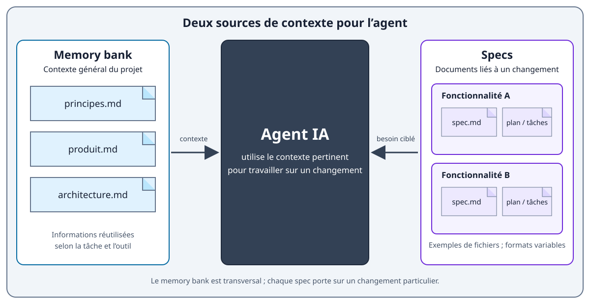
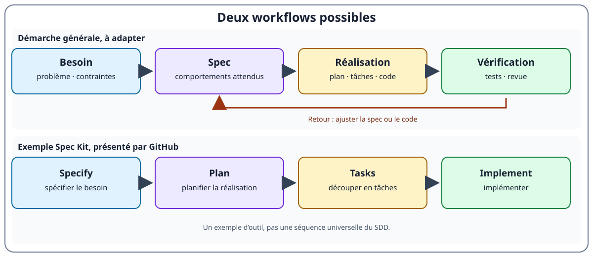
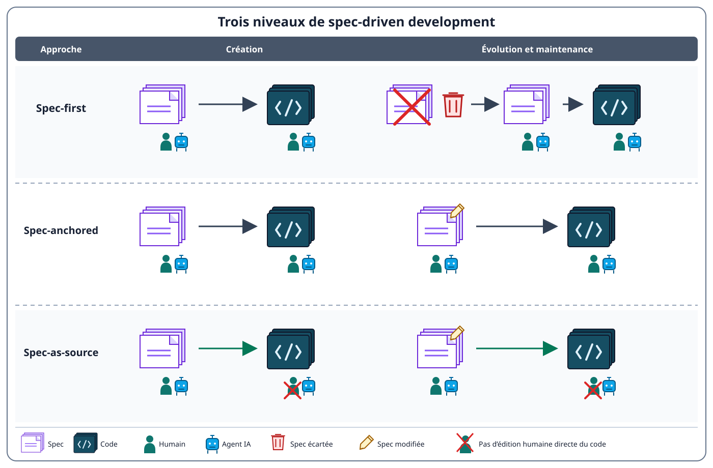

# Le développement piloté par les spécifications (Spec-Driven Development - SDD)

- **Créé le :** 13 novembre 2026
- **Dernière mise à jour :** 13 novembre 2026
- **Rédaction :** avec l’aide de l’IA

Avec un assistant de programmation fondé sur l’intelligence artificielle (IA), il est tentant de décrire une fonctionnalité en quelques phrases et de lui demander directement le code. Cette approche peut convenir à une petite expérimentation, mais elle laisse parfois des questions ouvertes : quel problème cherche-t-on à résoudre, quel comportement attend-on et comment saura-t-on que le résultat est correct ?

Le **Spec-Driven Development** (SDD, développement piloté par les spécifications) consiste à donner une place centrale à la description du besoin dans le travail de développement. Au lieu de passer directement de l’idée au code, on rend l’intention assez explicite pour guider les décisions et vérifier le résultat. Le terme est récent et sa définition reste variable : dans son analyse publiée en octobre 2025, Birgitta Böckeler distingue plusieurs niveaux de pratique, du simple document préalable au code jusqu’à une spécification conservée comme référence dans le temps.

## Partir du besoin, pas de la solution

Une spec décrit le comportement attendu d’un logiciel pour une fonctionnalité ou un changement. Birgitta Böckeler la définit comme un document structuré — ou un ensemble de documents liés — rédigé en langage naturel, centré sur le comportement et destiné à guider les agents de programmation. Sa forme et son niveau de détail varient selon les pratiques du SDD.

Une spec peut rassembler des scénarios d’usage, des critères d’acceptation, des règles métier et des cas limites. Elle précise ce que le logiciel doit faire et pourquoi, sans imposer d’emblée comment le réaliser. Elle doit être assez concrète pour être discutée et vérifiée, mais pas détailler chaque décision ni figer les questions encore ouvertes.

La spec, liée à une fonctionnalité, se distingue du **memory bank** (« mémoire de contexte ») : ce dernier contient des informations générales et durables — principes de l’équipe, présentation du produit ou architecture du dépôt — utiles à plusieurs tâches et sessions. Cette distinction proposée par Böckeler est une grille de lecture, pas une terminologie adoptée par tous les outils.

## Une démarche adaptable

Le SDD n’impose ni étapes fixes ni format de fichiers. Un cycle possible est de :

1. clarifier le problème, le périmètre et les contraintes ;
2. décrire les usages et résultats attendus, puis lever les ambiguïtés importantes ;
3. choisir une approche technique, découper le travail et réaliser le changement ;
4. vérifier le résultat et mettre à jour la spec si le besoin ou sa compréhension évolue.

GitHub présente aussi pour Spec Kit un enchaînement plus précis : Specify (spécifier), Plan (planifier), Tasks (découper en tâches), puis Implement (implémenter). C’est un exemple de workflow propre à un outil, pas une séquence universelle du SDD .

Dans sa présentation de Spec Kit, GitHub décrit la spec comme une référence vivante, révisée par l’équipe et l’agent au fil du projet : on y revient si une décision pose problème, on l’affine quand le projet se complexifie et on découpe les tâches trop grandes. GitHub la qualifie aussi d’« exécutable » : elle guide la génération et la validation du code, sans que cela signifie qu’un document texte soit automatiquement exécutable par une machine.

Ces étapes s’adaptent au contexte : une fonctionnalité risquée ou discutée par plusieurs personnes peut mériter une spec détaillée, tandis qu’une petite correction ou une expérience temporaire peut se contenter d’une note. Le formalisme doit rester proportionné au changement.

## Que devient la spécification après l’implémentation ?

La réponse à cette question marque une différence importante entre les pratiques regroupées sous le terme SDD. Dans son analyse, Birgitta Böckeler propose trois niveaux pour les distinguer :

- **Spec-first** : la spécification guide la réalisation d’un changement, mais n’est pas nécessairement conservée ensuite comme référence durable.
- **Spec-anchored** : la spécification est gardée et mise à jour pour guider les évolutions futures de la fonctionnalité.
- **Spec-as-source** : la spécification devient l’artefact principal que l’on modifie ; l’humain édite la spec, et le code est généré à partir d’elle plutôt que modifié directement.

Cette classification proposée par Böckeler n’est pas un standard. Elle souligne un choix à faire : conserver les specs et les maintenir à jour, ou les utiliser seulement pendant le changement. Une documentation obsolète induit en erreur ; tout documenter durablement peut aussi créer du travail inutile.

## Atouts et limites

Avec l’IA, une spec peut aider l’assistant à comprendre l’objectif, à poser des questions et à proposer un plan ou du code. Des exigences floues peuvent cependant conduire à une solution qui ne répond pas au besoin. Il faut relire les documents et le code, exécuter les tests et vérifier les exigences de qualité et de sécurité : ni la spec ni l’IA ne garantissent un logiciel correct.

Des exemples et critères concrets facilitent la discussion et la vérification, mais trop de détails peuvent répéter le code ou ralentir les changements. Les assistants peuvent aussi produire de nombreux documents redondants : leur revue par les humains devient alors chronophage et les éléments importants plus difficiles à repérer, un écueil relevé par Böckeler dans son analyse des outils SDD. Le SDD doit rendre l’intention assez claire pour guider le travail, sans faire de la documentation une fin en soi.

L’adoption dans un projet existant peut aussi demander un effort : le dépôt n’a pas toujours de specs, ou ses documents ne suivent pas les conventions de l’outil choisi. Certains outils installent leur propre structure et leur workflow, qu’il faut intégrer ou adapter. Par exemple, [Spec Kit ajoute ses fichiers de projet et d’intégration sans déduire les specs du comportement existant](https://github.github.io/spec-kit/how-to/existing-projects.html) ; son guide recommande de commencer par un changement délimité plutôt que de spécifier tout le système. L’intégration d’outils SDD dans une base de code existante peut ainsi prendre du temps, comme le relève aussi Böckeler.

## Références complémentaires

- Birgitta Böckeler, [« Understanding Spec-Driven-Development: Kiro, spec-kit, and Tessl »](https://martinfowler.com/articles/exploring-gen-ai/sdd-3-tools.html), *Martin Fowler*, 15 octobre 2025. Analyse des définitions du SDD, des différents niveaux d’approche et des outils qui les mettent en œuvre.
- Den Delimarsky, [« Spec-driven development with AI »](https://github.blog/ai-and-ml/generative-ai/spec-driven-development-with-ai-get-started-with-a-new-open-source-toolkit/), *GitHub Blog*, 2 septembre 2025. Présentation du processus avec Spec Kit.
- Liu Shangqi, [« Spec-driven development: Unpacking one of 2025’s key new AI-assisted engineering practices »](https://www.thoughtworks.com/en-us/insights/blog/agile-engineering-practices/spec-driven-development-unpacking-2025-new-engineering-practices), *Thoughtworks*, 4 décembre 2025. Analyse des définitions et des choix de conception autour du SDD.
- Rich Naszcyniec, [« How spec-driven development improves AI coding quality »](https://developers.redhat.com/articles/2025/10/22/how-spec-driven-development-improves-ai-coding-quality), *Red Hat Developer*, 22 octobre 2025. Présente une approche pratique où les humains définissent les besoins et valident le code produit par l’IA.

## Historique des mises à jour

- 2026-11-13 — Création de l’article.
