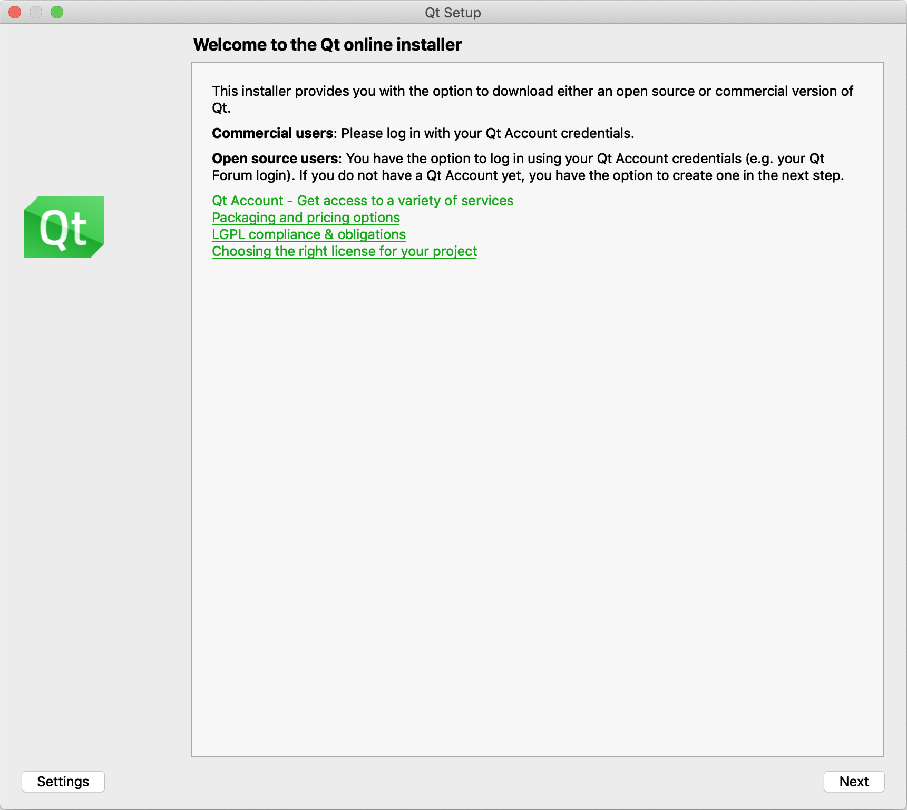
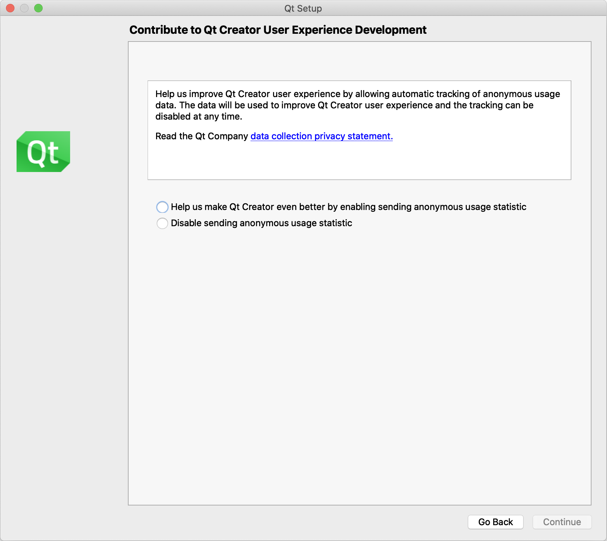
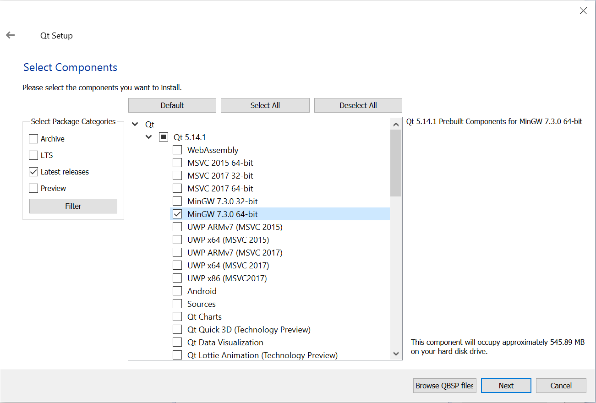

# Installer Qt

> [Revenir à la page d'installation de Qt 6](README.md)

Les étapes et les captures ci-dessous sont indicatives : l'interface et les composants proposés varient avec la version de
l'installateur, le système, le compte et la licence. Pour les instructions actuelles, consultez [Get and Install Qt](https://doc.qt.io/qt-6/qt-online-installation.html).

1. Lancez Qt Online Installer téléchargé depuis le site officiel et connectez-vous à votre compte Qt.
2. Examinez les conditions de licence associées à votre usage, puis sélectionnez les composants nécessaires.
3. Choisissez un répertoire d'installation accessible en écriture. Évitez les chemins contenant des caractères particuliers
   ou trop longs, notamment pour certains outils Windows.
4. Sélectionnez une version de Qt, les modules nécessaires et un kit desktop avec son compilateur. Pour apprendre, une seule
   cible desktop suffit. N'installez les outils Android/iOS que si vous développez pour ces plateformes.
5. Validez la sélection, les licences des composants et l'espace disque, puis lancez l'installation.

Les captures d'écran ci-dessous montrent une ancienne version de l'installateur Qt 6 : elles illustrent le déroulement
général, pas les noms ou versions actuels des choix.

Qt Maintenance Tool est installé avec Qt et permet ensuite d'ajouter, retirer et mettre à jour des composants. Les
conditions d'utilisation dépendent de la licence et des modules choisis : lisez-les attentivement et vérifiez que votre
usage respecte les termes applicables. Voir [Licences Qt](https://www.qt.io/licensing/).
