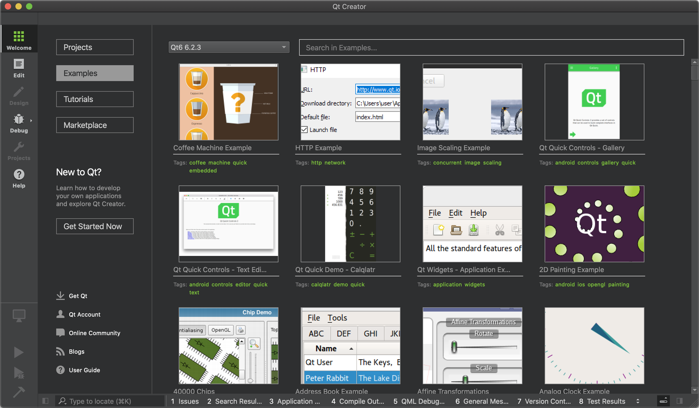

# Explorer les exemples Qt

> [Revenir à la page précédente](README.md)

Qt Online Installer propose des exemples avec les modules installés. Dans Qt Creator, ouvrez la page **Examples**, filtrez
par module ou recherchez un sujet, puis ouvrez et exécutez un exemple compatible avec le kit actif.

Les captures ont été réalisées avec une ancienne version de Qt Creator. Dans les versions actuelles, l'accès aux exemples
peut se trouver ailleurs, mais les projets livrés avec Qt restent une bonne façon d'apprendre une API. Avant d'adapter un
exemple à votre application :

- vérifiez le module et la version Qt utilisés ;
- lisez le `CMakeLists.txt` et repérez les ressources et imports QML ;
- construisez l'exemple avant de modifier le code ;
- consultez la documentation des classes ou types utilisés.

Les exemples et tutoriels officiels sont également accessibles depuis la [documentation Qt 6](https://doc.qt.io/qt-6/).
