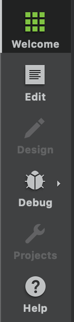
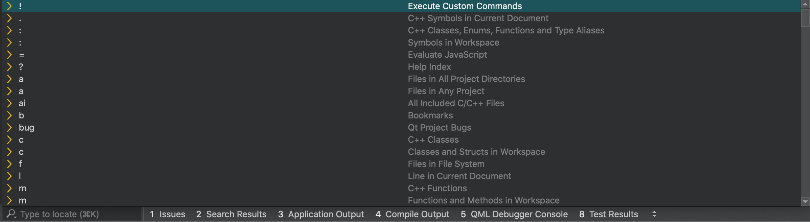

# L'interface de Qt Creator

> [Revenir à la page précédente](README.md)

L'interface de Qt Creator évolue entre les versions et selon les extensions installées. Les captures ci-dessous ne sont
donc qu'un repère visuel ; les noms des menus et leur disposition peuvent différer.

## Accueil et édition

Le mode d'accueil permet de créer ou ouvrir un projet, de parcourir les exemples et de gérer les sessions. Le mode d'édition
affiche les fichiers source et l'arborescence du projet. Les vues **Projects**, **Issues**, **Application Output**,
**Compile Output** et **Debugger** aident à configurer et diagnostiquer le projet. Un panneau peut être masqué ou déplacé
selon la disposition choisie.

## Construire, exécuter et déboguer

Lorsqu'un projet est ouvert, sélectionnez un kit et une configuration (**Debug** ou **Release**) dans la barre de projet
ou dans **Projects > Build & Run**. **Build** compile le projet ; **Run** le construit si nécessaire puis le lance ;
**Start Debugging** le lance sous le débogueur. Les raccourcis clavier peuvent varier selon le système et la configuration.

Un kit désigne une combinaison de plateforme, compilateur, version de Qt et outils. Si aucun kit valide n'est disponible,
consultez [la configuration des kits](../installation/config.md).

## Rechercher et obtenir de l'aide

Le **Locator** permet de rechercher des fichiers, symboles et commandes. Utilisez `Ctrl+K` sous Windows/Linux ou `Cmd+K`
sous macOS. Pour consulter la documentation d'un symbole, placez le curseur dessus et appuyez sur `F1` lorsque l'aide est
installée et configurée.

